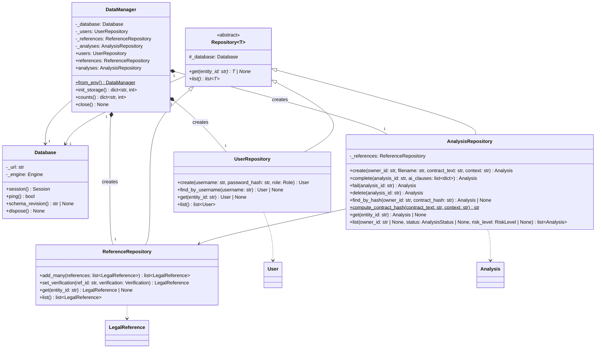
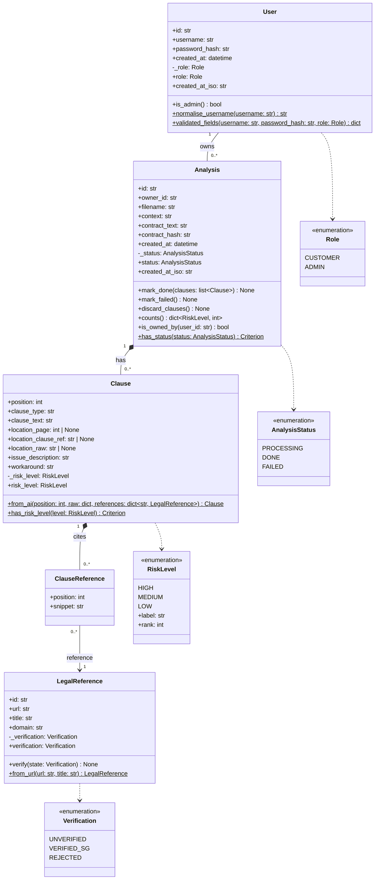
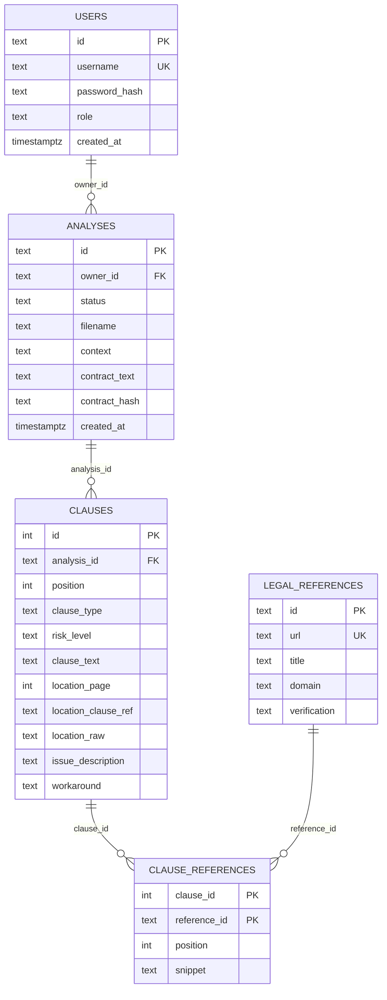

# Data layer: class diagrams (draft for review)

Notation: `-` private, `+` public, `#` protected, italics / `<<abstract>>` abstract, `*--` composition,
`o--` aggregation, `-->` association, `..>` dependency, `<|--` inheritance.
Entities are the domain objects. FK columns are persistence details, shown only in the ER view.
Diagram A shows the services (managers and repositories); diagram B shows the entities.

## A. Data Manager and repositories

## B. Entities

## Design decisions (and why)

| Decision | Reason (rubric / lab) |
|---|---|
| `Repository<T>` abstract with abstract `get` / `list`, subclasses override | Abstract class + inheritance + overriding; the three repositories share one shape |
| `DataManager` composes the three repositories | It creates them itself (composition, whole end `1`) |
| `Analysis ◆ Clause ◆ ClauseReference` | Cascade delete in the schema: parts die with the whole |
| `ClauseReference --> LegalReference` is an association | Shared references survive when an analysis is deleted |
| `User -- Analysis` is an association | A stored FK is not ownership of the lifecycle (Lab 8 trap) |
| `status`, `role`, `verification`, `risk_level` private + read-only property | Encapsulation: changed only through `mark_done()`, `verify()` ... which enforce the rules |
| `LegalReference.from_url`, `Clause.from_ai` | Removes the `ClauseParser -> ReferenceRepository` coupling; each class builds itself (SRP) |
| Enumerations instead of tuples of strings | Type hints show the allowed values; the UML shows them |
| Repositories return entities, not `dict` | Diagram and code correlate both ways |
| `Clause.category` removed | Never populated by the AI prompt |
| `ClauseReference` key `(clause_id, reference_id)` | Chosen; `position` stays an ordinary column; one clause citing the same URL twice is collapsed in `Clause.from_ai` |

## C. ER view (report "data storage design" section)

