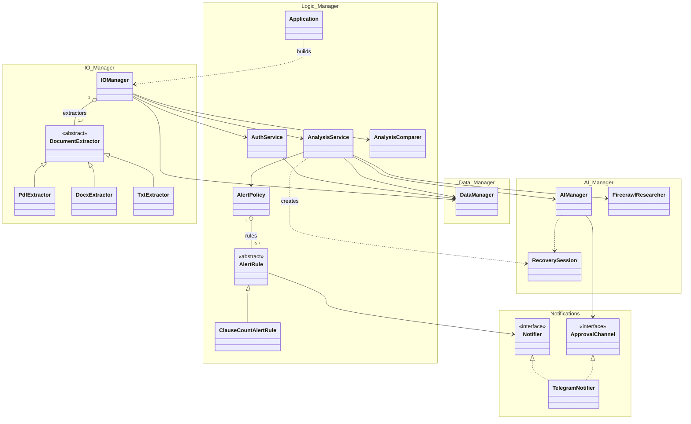
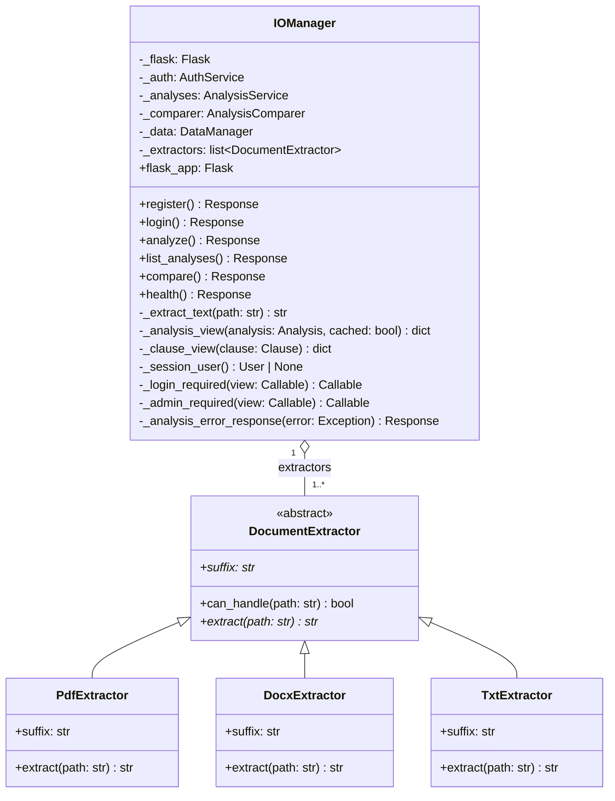
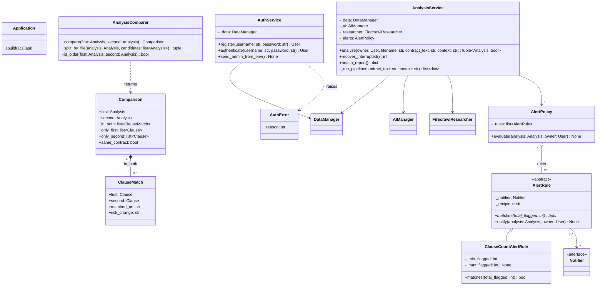
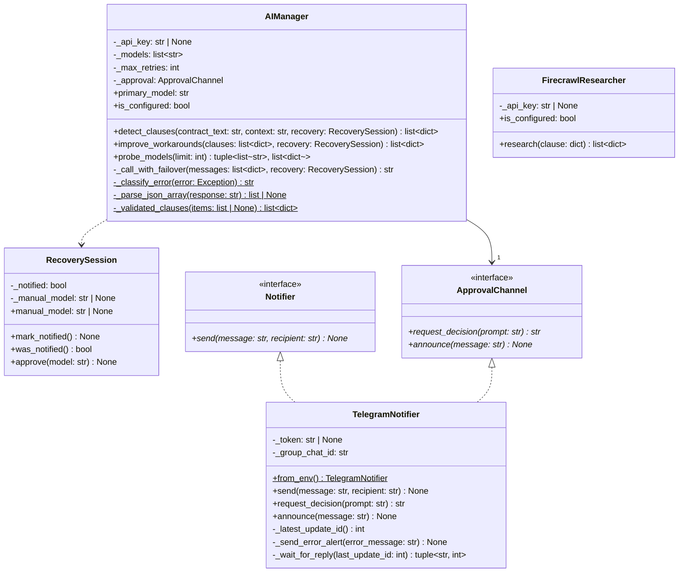

# System design: IO, AI, Logic, Notifications (matches the code)

Same notation as `uml-data-layer.md`. `<<interface>>` = ABC with abstract methods only; it is realised with a dashed
line and hollow triangle (`<|..`). The 13 route handlers are listed in the table at the end.

## D. Overview: the four managers and how they connect

## E. IO Manager

## F. Logic Manager

## G. AI Manager and notifications

## Design decisions (and why)

| Decision | Reason (rubric / lab) |
|---|---|
| `DocumentExtractor` abstract with `Pdf/Docx/Txt` subclasses | Replaces the `if suffix == ...` chain: abstract class + inheritance + overriding + polymorphism + OCP (a new format = a new subclass) |
| `IOManager o-- DocumentExtractor` | Extractors are created outside and injected: parts live independently of the whole (aggregation) |
| `AlertPolicy o-- AlertRule` | Rules exist without the policy and can be shared or swapped: aggregation. `AlertPolicy` only calls `rule.matches()` / `rule.notify()`: polymorphism, no type branching |
| `Notifier` and `ApprovalChannel` interfaces; `TelegramNotifier` realises both | "Can-do" capabilities, not "is-a": a class with no parent plus two interfaces (Lab 7). Telegram's Fix / Stop flow is unchanged, inside `request_decision()` |
| `RecoverySession` replaces the `recovery_state` dict | An object with private state and methods instead of a loose dict |
| Managers receive collaborators in the constructor | Association + dependency injection: loose coupling; tests pass fakes (no live AI) |
| `Application.build()` wires the object graph | One place knows the concrete classes; modules have no side effects when imported |
| `AuthService`, `AnalysisService`, `AnalysisComparer` split | SRP: login rules, the analysis pipeline and the compare feature change for different reasons |
| `Comparison` / `ClauseMatch` value objects | The compare feature returns typed results; `IOManager` only turns them into JSON |
| `FlaggedClause` dataclass dropped | Unused; `Clause.from_ai()` and `AIManager._validated_clauses()` validate AI output |

## Route handlers in `IOManager` (URLs and JSON unchanged)

| Method + path | Handler |
|---|---|
| POST `/api/auth/register`, POST `/api/auth/login`, GET `/api/auth/me`, POST `/api/auth/logout` | `register`, `login`, `current_user`, `logout` |
| POST `/api/analyze` | `analyze` |
| GET `/api/analyses`, GET / DELETE `/api/analyses/<id>` | `list_analyses`, `get_analysis`, `delete_analysis` |
| GET `/api/compare`, GET `/api/analyses/<id>/compare-options` | `compare`, `compare_options` |
| GET `/api/admin/users`, GET `/api/admin/analyses` | `admin_users`, `admin_analyses` |
| GET `/api/health` | `health` |
